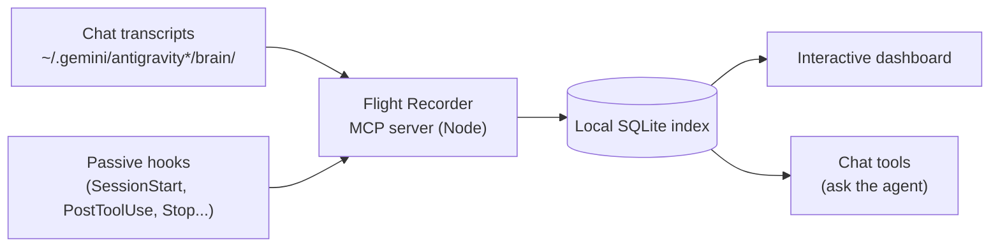

# Flight Recorder (`flight-recorder`)

**See which plugins, skills, MCP servers, tools, and models drive your tokens, prompt-cache carry, estimated USD, and active agent time in Google Antigravity — and get concrete steps to optimize them.**

Flight Recorder is a local-only **Antigravity plugin with an interactive MCP App dashboard**. It works with **Antigravity 2.x (Hub)**, the **Antigravity IDE**, and the **Antigravity CLI (`agy`)** on **Windows, macOS, and Linux**.

---

## What It Is & How It Works

Every Antigravity chat leaves a transcript on disk. Flight Recorder reads those transcripts, enriches them with lightweight lifecycle-hook events, and indexes everything into a local SQLite database. It then attributes every step's tokens, cache reads, and wall-clock time to the **parent plugin or top-level skill** that caused it — including downstream model reasoning and subagent runs.



- **Sources:** transcripts from `~/.gemini/antigravity/brain`, `~/.gemini/antigravity-ide/brain`, and `~/.gemini/antigravity-cli/brain` (plus any transcript paths reported by hooks).
- **History included:** existing chats are backfilled on the first scan, so you see past projects immediately.
- **Two ways to use it:** an interactive dashboard, or by asking your agent questions in chat (the bundled `flight-recorder` skill tells the agent which tool to call).

---

## Prerequisites

- **Antigravity 2.x (Hub)**, Antigravity IDE, or Antigravity CLI (`agy`)
- **Node.js `>= 22.15`** on your `PATH` (check with `node -v`) — required for the built-in `node:sqlite` module

> **Zero build steps required:** prebuilt, self-contained server and UI bundles (`dist/`) are committed to the repository — **no `npm install`, TypeScript build, or Python is needed.**

---

## Installation

All Antigravity surfaces auto-discover plugins placed in your global plugins folder:

- **macOS / Linux:** `~/.gemini/config/plugins/flight-recorder`
- **Windows:** `%USERPROFILE%\.gemini\config\plugins\flight-recorder`

### Option 1: Git (Recommended)

**macOS / Linux (Terminal):**
```bash
git clone https://github.com/fmedery/antigravity-plugin-flight-recorder ~/.gemini/config/plugins/flight-recorder
```

**Windows (PowerShell):**
```powershell
git clone https://github.com/fmedery/antigravity-plugin-flight-recorder "$HOME\.gemini\config\plugins\flight-recorder"
```

**Windows (Command Prompt / `cmd.exe`):**
```cmd
git clone https://github.com/fmedery/antigravity-plugin-flight-recorder "%USERPROFILE%\.gemini\config\plugins\flight-recorder"
```

### Option 2: Download ZIP (no Git)

1. On GitHub, click **Code → Download ZIP** and extract the archive.
2. Rename the extracted folder to `flight-recorder` and move it into your plugins directory so `plugin.json` sits directly at:
   - **Windows:** `%USERPROFILE%\.gemini\config\plugins\flight-recorder\plugin.json`
   - **macOS / Linux:** `~/.gemini/config/plugins/flight-recorder/plugin.json`
   > **Important:** `plugin.json` must be directly inside `flight-recorder/` — not nested one level deeper (e.g. `flight-recorder/antigravity-plugin-flight-recorder-main/plugin.json`).

### Option 3: Ask Antigravity in Chat

Paste this prompt into any Antigravity conversation:

> Install `https://github.com/fmedery/antigravity-plugin-flight-recorder` into my global Antigravity plugins folder as `flight-recorder`.

### Option 4: Antigravity CLI (`agy`)

```bash
agy plugin install https://github.com/fmedery/antigravity-plugin-flight-recorder
```

---

## Verify & Open

1. **Check it's enabled:** open **Left Sidebar → Customizations** and confirm **Flight Recorder** is listed and toggled **On**.
2. **Restart Antigravity 2.x (Hub):** the plugin appears in the Customizations list right away, but its dashboard entry in the Left Sidebar and the chat `+` menu only shows up after you fully quit and reopen the app.
3. **Open the dashboard** any of these ways:
   - **Full-page (all projects):** click **Flight Recorder** in the **Left Sidebar**.
   - **Side pane (inside a chat):** click the **`+`** button in the chat's auxiliary pane and select **Flight Recorder**.
   - **From chat:** ask *"Open Flight Recorder to inspect this project"*.

---

## Using the Dashboard

Navigate with the breadcrumb at the top (**All Projects / *project* / *chat***). Two global controls are always available:

- **Time range** — `Today`, `7d`, `30d`, or `All time`; every view, KPI, and leaderboard is filtered to the selected window.
- **Top-right buttons** — **Rescan** re-indexes transcripts and hook events on demand; **Pricing** opens per-model USD rates.

Every KPI card has a **`?`** tip explaining what the metric means and why it matters.

### 1. All Projects (home)

KPIs: **Projects**, **Total Tokens**, **Active Time**, **Est. Cost**.

| Tab | What you get |
|---|---|
| **Projects** | Every tracked workspace with tokens, active time, and cost. Filter and sort, then click a row to drill in. |
| **Plugins & Models** | The global **parent-first plugin & skill leaderboard** and model mix across all projects. |
| **Recent Chats** | Latest chats across all projects — click one to open its timeline. |

### 2. Project view

KPIs: **Chats** (incl. subagents), **Total Tokens**, **Active Time**, **Est. Cost**.

| Tab | What you get |
|---|---|
| **Overview** | Model mix, recent chats, and the project's top plugins & skills. |
| **Usage** | Sub-tabs for **Plugins & Skills**, **Models**, **Tools**, and **Files** touched. |
| **Chats** | Every chat and subagent run in the project. |

### 3. Chat view

KPIs: **Active Time**, **Turns & Wait**, **Tokens & Cache**, **Est. Cost**. Use **Reassign** to move a chat to a different project if it was attributed to the wrong workspace.

| Tab | What you get |
|---|---|
| **Timeline** | Turn-by-turn waterfall separating **active agent time** (model + parallel-merged tools + subagents) from **user wait / idle**, with cache-miss and subagent markers. |
| **Tokens & Models** | Per-step context bars with **`200k` cliff** and **`256k` compaction** thresholds, cache-miss flags, and per-model breakdown with **orchestrator model-switch** detection. |
| **Plugins & Tools** | The chat's plugin & skill leaderboard and per-tool metrics. |

### The plugin & skill leaderboard

This is where most optimization starts:

- **Parent-first:** rows are top-level plugins or standalone skills (e.g. `Superpowers`, `Cloudflare`, `Gmail`), so you see what drives most of your spend and time *before* drilling into sub-skills, MCP tools, or CLIs. Click a row to expand its children.
- **Filter & sort:** `All / Plugins / Skills`, sorted by **Spend & Time** or **Context Tokens** (instruction-markdown carry vs. tool-execution output).
- **Waste badges:**
  - **Unused load** — a tool-backed `SKILL.md` sat in context, but the chat never called its CLI or MCP tools.
  - **N× read** — the same `SKILL.md` was read multiple times.
  - Red **err** badges — click to open a guidance drawer with error samples, what it means, and how to fix it.
- **Optimize With Agent** — sends a prompt to your agent to propose concrete `SKILL.md` / workflow improvements (or **Copy Optimization Prompt** where sending isn't available).

### Pricing

Costs are estimates based on per-1M **input / cache-read / output** USD rates. Models without a configured rate are honestly labeled **`Unpriced`** rather than guessed — click **Pricing** (or any `Unpriced` badge) to add or edit rates.

---

## Asking in Chat

You don't have to open the dashboard. Ask your agent and it will call Flight Recorder's tools and cite exact step indices, token counts, and durations.

| Ask something like… | Tool used |
|---|---|
| *"Which projects are tracked and what are my most token-hungry plugins?"* | `list_projects` |
| *"Which plugins and skills drove spend and active time in this project?"* | `get_project_summary` |
| *"Break down this chat turn by turn. When did the model switch?"* | `get_chat_analysis` |
| *"Which plugin caused most of my spend? How can we optimize our skills?"* | `get_skill_optimization` |
| *"Why did this chat use so many tokens?"* / *"Why was this slow?"* | `explain_bottlenecks` |
| *"Open Flight Recorder on this chat."* | `open_flight_recorder` |

`explain_bottlenecks` returns ranked root causes, including **compounded cache carry**, **`200k` / `256k` compaction cliffs**, **unused or high-overhead skills**, **duplicate `SKILL.md` reads**, **tool retry thrash**, **subagent delegation candidates**, **prompt cache misses** (TTL expiry, model switches, compaction), and the slowest model/tool steps.

---

## Updating & Uninstalling

### Update (Git installs)

- **macOS / Linux:**
  ```bash
  git -C ~/.gemini/config/plugins/flight-recorder pull
  ```
- **Windows (PowerShell):**
  ```powershell
  git -C "$HOME\.gemini\config\plugins\flight-recorder" pull
  ```

After pulling, toggle the `flight-recorder_recorder` server off/on in **Settings → MCP Servers** so the running Node process loads the new bundle.

### Uninstall

- **In Antigravity 2.x:** open **Left Sidebar → Customizations → Flight Recorder** to disable or uninstall it.
- **Optional — remove the local index & hook log:** delete `~/.gemini/flight-recorder-data` (`%USERPROFILE%\.gemini\flight-recorder-data` on Windows) or your plugin's `${PLUGIN_DATA}` directory.

---

## Privacy & Security

- **100% local, zero network:** no telemetry, analytics, or external requests (`default-src 'none'` iframe CSP).
- **Passive-only hooks:** uses only `SessionStart`, `PreInvocation`, `PostToolUse`, `PostInvocation`, and `Stop` — never `PreToolUse` — and fails open (`{}`) on any error, so it can never block your agent.
- **Redacted & owner-private storage:** API keys, Bearer tokens, JWTs, URL credentials, and ANSI/OSC escape sequences are scrubbed from previews before indexing. Data files use `0700`/`0600` owner-only permissions on macOS/Linux and private `%USERPROFILE%` ACLs on Windows.

See [SECURITY.md](./SECURITY.md) for the full audit table.

---

## Troubleshooting

- **Flight Recorder doesn't appear in the sidebar:**
  1. If it's already listed under **Customizations**, fully quit and restart Antigravity 2.x (Hub). The dashboard entry only shows up after a restart.
  2. Confirm `plugin.json` is directly at `.../plugins/flight-recorder/plugin.json` (not nested from a ZIP extract).
  3. Run `node -v` and verify **Node.js `>= 22.15.0`**.
  4. Check **Settings → MCP Servers** to confirm `flight-recorder_recorder` is running, or restart it.
- **A recent chat is missing:** click **Rescan**, and check the time-range filter isn't hiding it.
- **A chat is under the wrong project:** open the chat and use **Reassign**.
- **Models show `Unpriced`:** click **Pricing** to add per-1M USD rates for those model families.

---

## Contributing & Local Development

If you're modifying Flight Recorder's TypeScript or React source:

```bash
npm install
npm run build          # Type-checks & bundles dist/server/index.js + dist/ui/index.html
npm test               # Unit, Windows path, security, and zero-node_modules stdio tests
npm run install-plugin # Links this checkout into ~/.gemini/config/plugins/flight-recorder (junction on Windows)
```

Remember to commit the rebuilt `dist/` — users run the prebuilt bundles directly.

| Path | Purpose |
|---|---|
| `src/server/` | MCP server: transcript scanner/parser, hook ingestor, SQLite, analytics, tools |
| `src/ui/` | React dashboard (bundled into a single `dist/ui/index.html`) |
| `src/shared/` | Paths, pricing, redaction, time-range helpers shared by server and UI |
| `hooks/` | Passive lifecycle-hook recorder |
| `skills/flight-recorder/` | Skill that teaches the agent when and how to use the tools |

## License

[MIT](./LICENSE) © Frederic Medery
