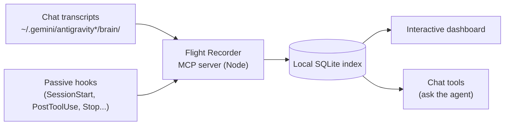
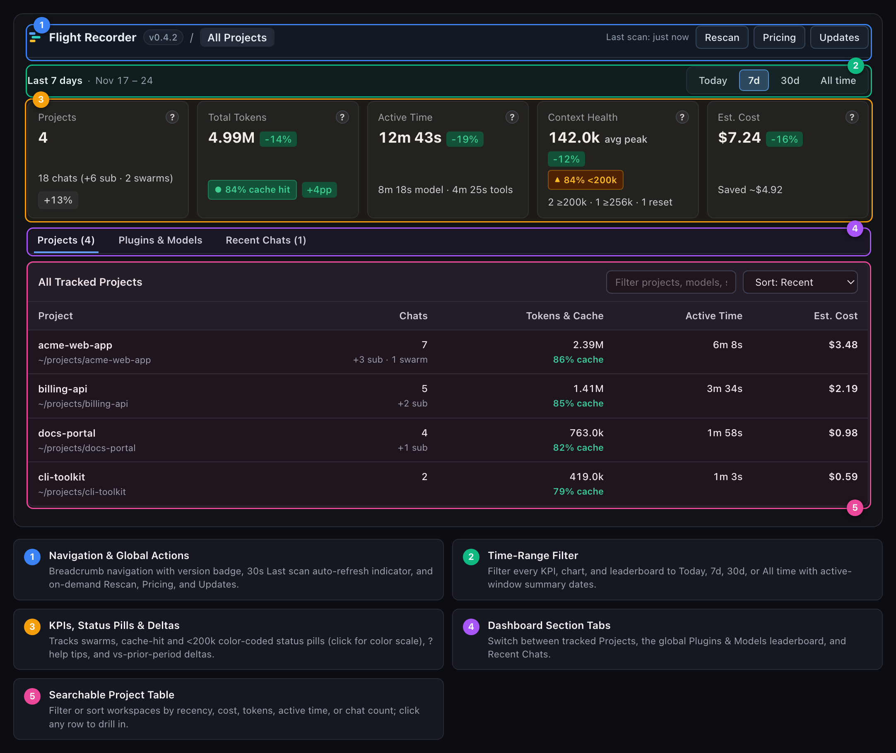
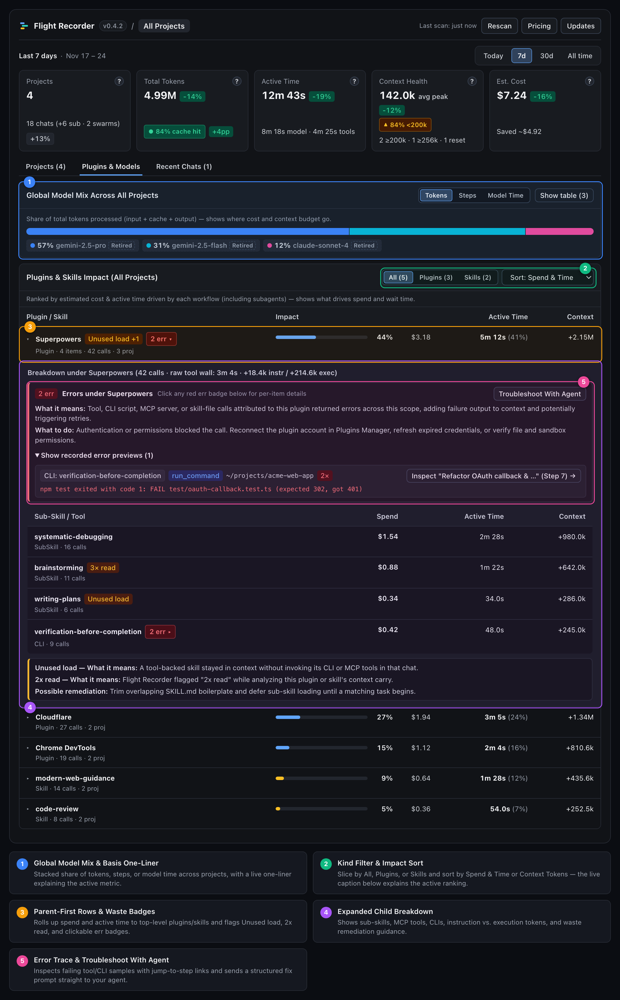
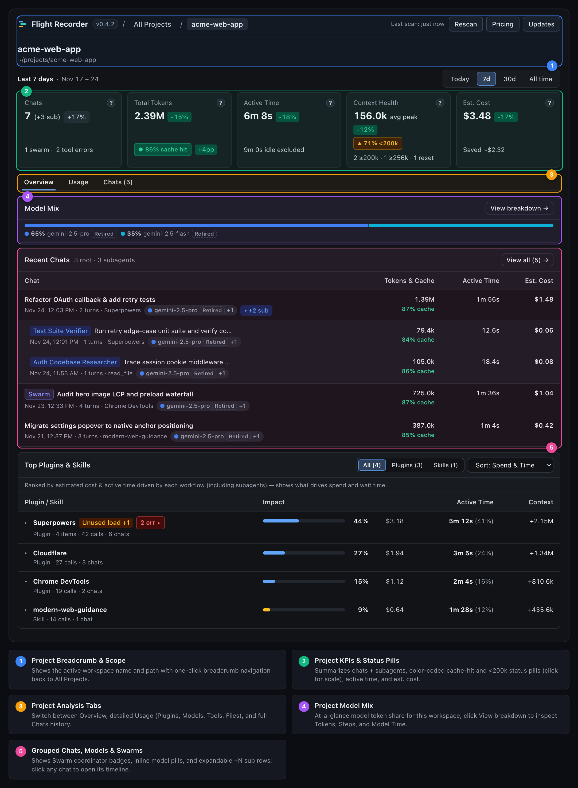
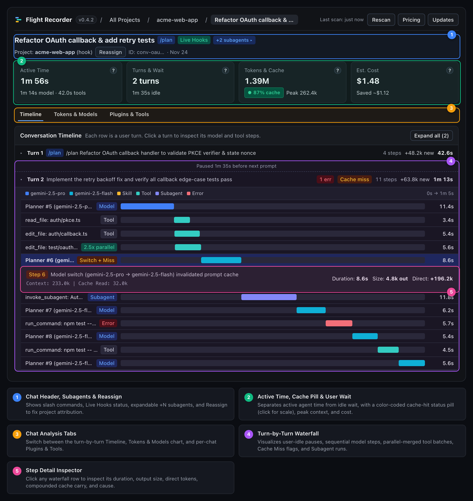
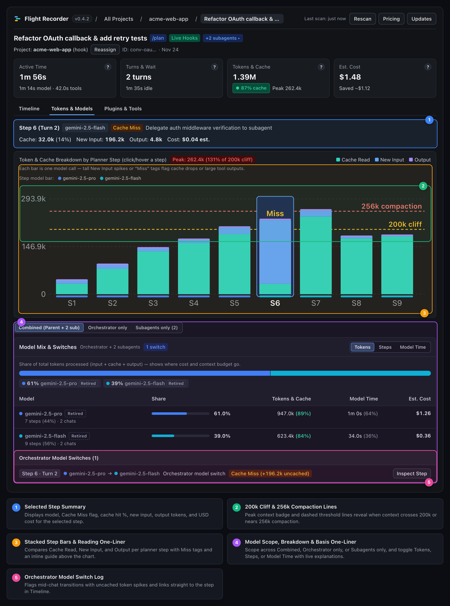

# Flight Recorder (`flight-recorder`)

**See which plugins, skills, MCP servers, tools, and models drive your tokens, prompt-cache carry, estimated USD, and active agent time in Google Antigravity — and pinpoint concrete bottlenecks across projects and chats.**

Flight Recorder is a **local-first Antigravity plugin with an interactive MCP App dashboard** — all transcript parsing and SQLite indexing stay on your machine, with zero background network calls or telemetry. It works with the **Antigravity App (2.x)**, **Antigravity IDE**, and **Antigravity CLI (`agy`)** on **Windows, macOS, and Linux**.

[How It Works](#how-it-works) · [Dashboard](#using-the-dashboard) · [Asking in Chat](#asking-in-chat) · [Install](#installation--setup) · [Updating](#updating--uninstalling) · [Privacy](#privacy--security) · [Troubleshooting](#troubleshooting)

---

## How It Works

Every Antigravity chat leaves a transcript on disk. Flight Recorder reads those transcripts, enriches them with lightweight lifecycle-hook events, and indexes everything into a local SQLite database. It then attributes every step's tokens, cache reads, and wall-clock time to the **parent plugin or top-level skill** that caused it — including downstream model reasoning and subagent runs.



- **Sources:** transcripts from `~/.gemini/antigravity/brain`, `~/.gemini/antigravity-ide/brain`, and `~/.gemini/antigravity-cli/brain` (plus any transcript paths reported by hooks).
- **History included:** existing chats are backfilled on the first scan, so you see past projects immediately.
- **Two ways to use it:** an interactive dashboard, or by asking your agent questions in chat (the bundled `flight-recorder` skill tells the agent which tool to call).

---

## Using the Dashboard

Navigate with the breadcrumb at the top (**All Projects / *project* / *chat***). Two global controls are always available:

- **Time range** — `Today`, `7d`, `30d`, or `All time`; every view, KPI, and leaderboard is filtered to the selected window, and `Today` / `7d` / `30d` display period-over-period delta pills (`vs yesterday`, `vs prior 7d`, `vs prior 30d`).
- **Top-right bar** — **`Last scan`** shows when the index last refreshed (automatically checks for changes every 30s while visible); **Rescan** re-indexes transcripts and hook events on demand; **Pricing** opens per-model USD rates; **Updates** checks GitHub for a newer version on demand (never runs automatically in the background).

Every KPI card has a **`?`** tip explaining what the metric means and why it matters, and **Prompt Cache Hit** (`≥80%` `●` green Healthy, `60–79%` `▲` yellow Watch, `<60%` `◆` red Low) and **Context Health `% <200k`** (`≥85%` `●` green Healthy, `60–84%` `▲` yellow Watch, `<60%` `◆` red High risk) render color-coded status pills — hover or click any pill or **`?`** icon to see the exact breakdown and **Color scale** legend. Panel controls (**Tokens / Steps / Model Time**, **Spend & Time / Context Tokens**, **Context Impact / Wall Time**, **Files**, and the step token chart) also display an inline one-liner explaining the active view plus hover tooltips on every button.

### 1. All Projects (home)

KPIs: **Projects** (with subagent and **Swarm** counts), **Total Tokens** (with color-coded cache-hit status pill), **Active Time**, **Context Health** (avg peak context, color-coded `% <200k` status pill, `200k` cliff / `256k` compaction hits, and resets), **Est. Cost**.

| Tab | What you get |
|---|---|
| **Projects** | Every tracked workspace with tokens, active time, and cost. Filter and sort, then click a row to drill in. |
| **Plugins & Models** | The global **parent-first plugin & skill leaderboard** and model mix across all projects. |
| **Recent Chats** | Latest chats across all projects — click one to open its timeline. |



### 2. Plugins & Skills leaderboard

Available globally on the **Plugins & Models** tab as well as per-project and per-chat — this is where most optimization starts:

- **Parent-first:** rows are top-level plugins or standalone skills (e.g. `Superpowers`, `Cloudflare`, `Gmail`), so you see what drives most of your spend and time *before* drilling into sub-skills, MCP tools, or CLIs. Click a row to expand its children.
- **Filter & sort:** `All / Plugins / Skills` (with hover tooltips distinguishing parent-level plugins from standalone skills), sorted by **Spend & Time** or **Context Tokens** with a live one-liner explaining the active ranking.
- **Waste badges:**
  - **Unused load** — a tool-backed `SKILL.md` sat in context, but the chat never called its CLI or MCP tools.
  - **N× read** — the same `SKILL.md` was read multiple times.
  - Red **err** badges — click to open an inline error drawer with recorded samples, what it means, remediation steps, and **Troubleshoot With Agent**.



### 3. Project view

KPIs: **Chats** (incl. subagents and **Swarms**), **Total Tokens** (with color-coded cache-hit status pill), **Active Time**, **Context Health** (with color-coded `% <200k` status pill), **Est. Cost**.

| Tab | What you get |
|---|---|
| **Overview** | Model mix, recent chats (with inline model pills and expandable subagent / **Swarm** worker rows), and the project's top plugins & skills. |
| **Usage** | Sub-tabs for **Plugins & Skills**, **Models** (toggle **Tokens**, **Steps**, or **Model Time** share, with auto-detected **Retired / Unavailable** tags), **Tools** (sort by **Context Impact** or **Wall Time**), and **Files** (`r` read · `e` edit · `c` create touches and `Context Carry`, click to open). |
| **Chats** | Every chat, **Swarm** coordinator/worker run, and subagent in the project with inline model pills. |



### 4. Chat view

KPIs: **Active Time**, **Turns & Wait**, **Tokens & Cache** (with color-coded cache-hit status pill), **Est. Cost**. Use **Reassign** to move a chat to a different project if it was attributed to the wrong workspace. For **Swarm** sessions, **Swarm Coordinator** / **Swarm Worker** badges, expandable worker chips with inline model pills, and a **Combined Swarm** vs. **Coordinator only** KPI toggle let you inspect team totals or coordinator overhead alone.

| Tab | What you get |
|---|---|
| **Timeline** | Turn-by-turn waterfall separating **active agent time** (model + parallel-merged tools + subagents) from **user wait / idle**, with cache-miss and subagent markers. |
| **Tokens & Models** | Per-step context bars with **`200k` cliff** and **`256k` compaction** thresholds, cache-miss flags, a **Combined / Orchestrator only / Subagents only** (or **Workers only**) scope toggle, and per-model breakdown (**Tokens**, **Steps**, or **Model Time** share) with **orchestrator model-switch** detection. |
| **Plugins & Tools** | The chat's plugin & skill leaderboard and per-tool metrics. |

#### Timeline

Inspect each user turn, parallel tool batch, cache miss, subagent run, and step-level token attribution.



#### Tokens & Models

Track prompt-cache carry step by step against `200k` / `256k` context thresholds, scope models across **Combined**, **Orchestrator only**, or **Subagents / Workers only**, switch between **Tokens**, **Steps**, and **Model Time** shares, and spot orchestrator model switches.



### Pricing & Rate Sources

Costs are **local API-equivalent USD estimates** calculated per 1M **uncached input / cached read / output** tokens — they are **never fetched live** and do **not** represent official Antigravity subscription, quota, or AI-credit billing.

On first run (or via **Reset Defaults**), Flight Recorder seeds 5 static reference rules in [src/shared/pricing.ts](./src/shared/pricing.ts) based on public provider API list prices (standard tier, ≤200k context):

| Model Pattern | Input / 1M | Cache Read / 1M | Output / 1M | Static Reference Source |
|---|---:|---:|---:|---|
| `gemini-2.5-pro*` | `$1.25` | `$0.3125` | `$10.00` | [Google Gemini API Pricing](https://ai.google.dev/gemini-api/docs/pricing) (≤200k standard tier) |
| `gemini-2.5-flash*` | `$0.15` | `$0.0375` | `$0.60` | [Google Gemini API Pricing](https://ai.google.dev/gemini-api/docs/pricing) (standard tier) |
| `gemini-2.0-flash*` | `$0.10` | `$0.025` | `$0.40` | [Google Gemini API Pricing](https://ai.google.dev/gemini-api/docs/pricing) (standard tier) |
| `claude-sonnet-4*` | `$3.00` | `$0.30` | `$15.00` | [Anthropic API Pricing](https://docs.anthropic.com/en/docs/about-claude/pricing) (standard tier) |
| `claude-opus-4*` | `$15.00` | `$1.50` | `$75.00` | [Anthropic API Pricing](https://docs.anthropic.com/en/docs/about-claude/pricing) (standard tier) |

- **No guessed prices:** Any model outside those patterns (including newer models) is honestly labeled **`Unpriced`** rather than guessed.
- **Explicit custom rates:** Click **Pricing** (or any `Unpriced` badge) to view each rule's **Source** (`Gemini API`, `Anthropic API`, `Custom`, or `Custom (edited)`), edit built-in rates, or add new rules (newly added rules start at `$0` so you enter your exact rates). All overrides are stored locally in `${PLUGIN_DATA}/tracker.sqlite`.

---

## Asking in Chat

You don't have to open the dashboard. Ask your agent and it will call Flight Recorder's tools and cite exact step indices, token counts, and durations.

| Ask something like… | Tool used |
|---|---|
| *"Which projects are tracked and what are my most token-hungry plugins?"* | `list_projects` |
| *"Which plugins and skills drove spend and active time in this project?"* | `get_project_summary` |
| *"Break down this chat turn by turn. When did the model switch?"* | `get_chat_analysis` |
| *"Which plugin caused most of my spend? How can we optimize our skills?"* | `get_skill_optimization` |
| *"Why did this chat use so many tokens?"* / *"Why was this slow?"* | `explain_bottlenecks` |
| *"Open Flight Recorder on this chat."* | `open_flight_recorder` |

`explain_bottlenecks` returns ranked root causes, including **compounded cache carry**, **`200k` / `256k` compaction cliffs**, **unused or high-overhead skills**, **duplicate `SKILL.md` reads**, **tool retry thrash**, **subagent delegation candidates**, **prompt cache misses** (TTL expiry, model switches, compaction), and the slowest model/tool steps.

---

## Installation & Setup

### Prerequisites

- **Antigravity 2.x (Hub)**, Antigravity IDE, or Antigravity CLI (`agy`)
- **Node.js `>= 22.15`** on your `PATH` (check with `node -v`) — required for the built-in `node:sqlite` module

> **Zero build steps required:** prebuilt, self-contained server and UI bundles (`dist/`) are committed to the repository — **no `npm install`, TypeScript build, or Python is needed.**

### Install

#### Option 1: Antigravity CLI (`agy`) (Recommended)

```bash
agy plugin install https://github.com/fmedery/antigravity-plugin-flight-recorder
```

#### Option 2: Git Clone

All Antigravity surfaces auto-discover plugins placed in your global plugins folder (`~/.gemini/config/plugins/flight-recorder` on macOS/Linux, `%USERPROFILE%\.gemini\config\plugins\flight-recorder` on Windows):

**macOS / Linux (Terminal):**
```bash
git clone https://github.com/fmedery/antigravity-plugin-flight-recorder ~/.gemini/config/plugins/flight-recorder
```

**Windows (PowerShell):**
```powershell
git clone https://github.com/fmedery/antigravity-plugin-flight-recorder "$HOME\.gemini\config\plugins\flight-recorder"
```

**Windows (Command Prompt / `cmd.exe`):**
```cmd
git clone https://github.com/fmedery/antigravity-plugin-flight-recorder "%USERPROFILE%\.gemini\config\plugins\flight-recorder"
```

#### Option 3: Download ZIP (no Git)

1. On GitHub, click **Code → Download ZIP** and extract the archive.
2. Rename the extracted folder to `flight-recorder` and move it into your plugins directory so `plugin.json` sits directly at:
   - **Windows:** `%USERPROFILE%\.gemini\config\plugins\flight-recorder\plugin.json`
   - **macOS / Linux:** `~/.gemini/config/plugins/flight-recorder/plugin.json`
   > **Important:** `plugin.json` must be directly inside `flight-recorder/` — not nested one level deeper (e.g. `flight-recorder/antigravity-plugin-flight-recorder-main/plugin.json`).

#### Option 4: Ask Antigravity in Chat

Paste this prompt into any Antigravity conversation:

> Install `https://github.com/fmedery/antigravity-plugin-flight-recorder` into my global Antigravity plugins folder as `flight-recorder`.

### Verify & Open

1. **Check it's enabled:** open **Left Sidebar → Customizations** and confirm **Flight Recorder** is listed and toggled **On**.
2. **Restart Antigravity 2.x (Hub):** the plugin appears in the Customizations list right away, but its dashboard entry in the Left Sidebar and the chat `+` menu only shows up after you fully quit and reopen the app.
3. **Open the dashboard** any of these ways:
   - **Full-page (all projects):** click **Flight Recorder** in the **Left Sidebar**.
   - **Side pane (inside a chat):** click the **`+`** button in the chat's auxiliary pane and select **Flight Recorder**.
   - **From chat:** ask *"Open Flight Recorder to inspect this project"*.

---

## Privacy & Security

- **Zero background network, zero telemetry:** no analytics, crash reporting, or automatic requests (`default-src 'none'` iframe CSP). The only optional outbound request is checking GitHub's latest release (with a `plugin.json` fallback) when you manually click **Updates**.
- **Passive-only hooks:** uses only `SessionStart`, `PreInvocation`, `PostToolUse`, `PostInvocation`, and `Stop` — never `PreToolUse` — and fails open (`{}`) on any error, so it can never block your agent.
- **Redacted & owner-private storage:** API keys, Bearer tokens, JWTs, URL credentials, and ANSI/OSC escape sequences are scrubbed from previews before indexing. Data files use `0700`/`0600` owner-only permissions on macOS/Linux and private `%USERPROFILE%` ACLs on Windows.

See [SECURITY.md](./SECURITY.md) for the full audit table.

---

## Troubleshooting

- **Flight Recorder doesn't appear in the sidebar:**
  1. If it's already listed under **Customizations**, fully quit and restart Antigravity 2.x (Hub). The dashboard entry only shows up after a restart.
  2. Confirm `plugin.json` is directly at `.../plugins/flight-recorder/plugin.json` (not nested from a ZIP extract).
  3. Run `node -v` and verify **Node.js `>= 22.15.0`**.
  4. Check **Settings → MCP Servers** to confirm `flight-recorder_recorder` is running, or restart it.
- **A recent chat is missing:** click **Rescan**, and check the time-range filter isn't hiding it.
- **A chat is under the wrong project:** open the chat and use **Reassign**.
- **Models show `Unpriced`:** click **Pricing** to add per-1M USD rates for those model families.

---

## Updating & Uninstalling

> **Your data is safe across upgrades:** Indexed history, custom model pricing rules, and project reassignments live outside the plugin folder in `${PLUGIN_DATA}` (`~/.gemini/flight-recorder-data` on macOS/Linux, `%USERPROFILE%\.gemini\flight-recorder-data` on Windows). Pulling, resetting Git, or replacing the plugin folder never deletes your data.

You can check whether a newer version is available anytime by clicking **Updates** in the top-right of the Flight Recorder dashboard (manual check only; for Git installs, it also gives you a copyable `git -C ... pull` command for your exact folder).

### Upgrade an Antigravity-managed install

If you installed Flight Recorder through Antigravity (**Customizations → Installed** or `agy plugin install`), update it directly from Antigravity or re-run your `agy plugin install` command.

### Upgrade an existing Git install

Because prebuilt `dist/` bundles are committed to the repository, **no `npm install` or build step is needed** after pulling.

1. **Pull the latest changes:**
   - **macOS / Linux (Terminal):**
     ```bash
     git -C ~/.gemini/config/plugins/flight-recorder pull --ff-only
     ```
   - **Windows (PowerShell):**
     ```powershell
     git -C "$HOME\.gemini\config\plugins\flight-recorder" pull --ff-only
     ```
   - **Windows (Command Prompt / `cmd.exe`):**
     ```cmd
     git -C "%USERPROFILE%\.gemini\config\plugins\flight-recorder" pull --ff-only
     ```

   <details>
   <summary>If <code>git pull</code> fails due to local changes or line-ending conflicts</summary>

   If a previous update or local edit left modified files in the deployed plugin folder, reset it cleanly to `origin/main` (your SQLite index and pricing settings are stored elsewhere and won't be touched):

   - **macOS / Linux:**
     ```bash
     git -C ~/.gemini/config/plugins/flight-recorder fetch origin && git -C ~/.gemini/config/plugins/flight-recorder reset --hard origin/main
     ```
   - **Windows (PowerShell):**
     ```powershell
     git -C "$HOME\.gemini\config\plugins\flight-recorder" fetch origin; git -C "$HOME\.gemini\config\plugins\flight-recorder" reset --hard origin/main
     ```

   </details>

2. **Reload the plugin in Antigravity:**
   - Open **Settings → MCP Servers** and toggle `flight-recorder_recorder` **off and back on** so the running Node process loads the updated server and UI bundle.
   - If the update changed `plugin.json`, `hooks.json`, or `skills/`, fully **quit and reopen Antigravity** so the host picks up the new manifest and hooks.
3. **Verify:** Open the dashboard and click **Updates** to confirm you are on the latest version (and optionally **Rescan**).

### Upgrade an existing ZIP install (no `.git` folder)

If you originally installed via ZIP (clicking **Updates** shows ZIP instructions because there is no `.git` folder):

- **Option A — Switch to Git once (makes future updates one command):**
  Delete your existing `flight-recorder` plugins folder and clone fresh (your indexed data and pricing remain intact):
  - **macOS / Linux:**
    ```bash
    rm -rf ~/.gemini/config/plugins/flight-recorder && git clone https://github.com/fmedery/antigravity-plugin-flight-recorder ~/.gemini/config/plugins/flight-recorder
    ```
  - **Windows (PowerShell):**
    ```powershell
    Remove-Item -Recurse -Force "$HOME\.gemini\config\plugins\flight-recorder"; git clone https://github.com/fmedery/antigravity-plugin-flight-recorder "$HOME\.gemini\config\plugins\flight-recorder"
    ```
- **Option B — Replace with a new ZIP:**
  Download the latest ZIP from GitHub (**Code → Download ZIP**), replace your `flight-recorder` plugins folder so `plugin.json` sits directly at `.../plugins/flight-recorder/plugin.json`, and restart Antigravity (or toggle `flight-recorder_recorder` off/on in **Settings → MCP Servers**).

### Upgrade `agy` CLI or local dev symlink installs

- **Antigravity CLI (`agy`):** re-run `agy plugin install https://github.com/fmedery/antigravity-plugin-flight-recorder`, then reload the MCP server or restart Antigravity.
- **Local checkout linked with `npm run install-plugin`:** run `git pull` in your repo checkout (plus `npm run build` if you are editing TypeScript/React source), then toggle `flight-recorder_recorder` off/on in **Settings → MCP Servers**.

### Uninstall

- **In Antigravity 2.x:** open **Left Sidebar → Customizations → Flight Recorder** to disable or uninstall it.
- **Optional — remove the local index & hook log:** delete `~/.gemini/flight-recorder-data` (`%USERPROFILE%\.gemini\flight-recorder-data` on Windows) or your plugin's `${PLUGIN_DATA}` directory.

---

## Contributing & Local Development

If you're modifying Flight Recorder's TypeScript or React source:

```bash
npm install
npm run build          # Type-checks & bundles dist/server/index.js + dist/ui/index.html
npm test               # Unit, Windows path, security, and zero-node_modules stdio tests
npm run install-plugin         # Links this checkout into ~/.gemini/config/plugins/flight-recorder (junction on Windows)
npm run version:check          # Verifies plugin.json, package.json, package-lock.json, and dist/ version parity
npm run version:bump -- patch  # Bumps plugin.json + package.json + package-lock.json (patch | minor | major | X.Y.Z[-pre.N])
npm run release -- minor --dry-run  # Previews bump, CHANGELOG.md entry, build, tests, validation, and git tag
```

Remember to commit the rebuilt `dist/` — users run the prebuilt bundles directly.

| Path | Purpose |
|---|---|
| `src/server/` | MCP server: transcript scanner/parser, hook ingestor, SQLite, analytics, tools |
| `src/ui/` | React dashboard (bundled into a single `dist/ui/index.html`) |
| `src/shared/` | Paths, pricing, redaction, time-range helpers shared by server and UI |
| `scripts/record-event.mjs` | Passive lifecycle-hook recorder (executed via `hooks.json`) |
| `skills/flight-recorder/` | Skill that teaches the agent when and how to use the tools |

## License

[MIT](./LICENSE) © Frederic Medery
